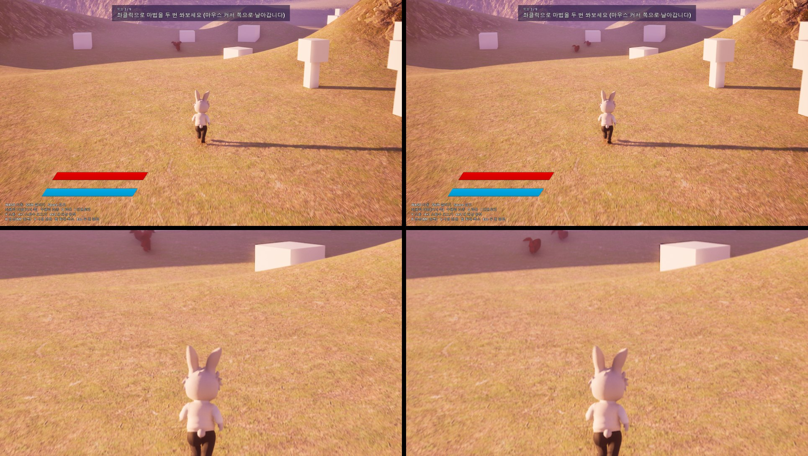

# 성능 측정과 개선 — v0.3.0 (2026-11-20)

**한 줄 요약:** 화면 차이 없이 GPU 시간을 **4.16ms → 3.70ms (−11%)** 줄였고, 1920×1080 평균 프레임이 **199 → 218fps (+10%)** 올랐습니다. 바꾼 것은 에픽 품질의 TSR 기록 해상도와 볼류메트릭 포그 격자 두 가지입니다.

## 1. 어떻게 쟀나

- **같은 길을 같은 순서로:** 설치본의 자동 점검 봇(`-DemoLoopTest`)이 튜토리얼을 실제 키 입력으로 출구까지 플레이합니다. 걷고 싸우는 구간(마법 목표 ~ 출구 도착)의 매 프레임을 기록합니다. 시작·실패·클리어 화면과 로딩은 뺍니다.
- **기록하는 값:** 프레임 시간, 게임 스레드, 렌더 스레드, GPU 시간. 끝날 때 평균·중앙값·95/99% 값을 로그에 남깁니다([DemoLoopTest.cpp](../../Source/DarkWolrd/Private/Character/DemoLoopTest.cpp)의 `LogPerformance`).
- **어디가 비싼지:** 엔진 CSV 프로파일러(`-csvCaptureFrames=20000 -csvGpuStats`)로 GPU 패스별 시간을 뽑았습니다.
- **환경:** 개발 PC (Windows 11 Pro, RTX 4080 SUPER, RAM 32GB), 패키지 설치본 v0.3.0 (Development), 1920×1080 창 모드, 에픽 품질.
- **설정 바꾸기:** 같은 설치본에 실행 옵션(`-ExecCmds`)으로 콘솔 변수만 바꿔 비교했습니다. 고른 설정은 프로젝트 설정에 넣고 다시 빌드해 한 번 더 쟀습니다.

## 2. 먼저 알게 된 것

| 발견 | 근거 | 판단 |
| --- | --- | --- |
| 최대 프레임이 260ms까지 튀는 끊김이 판마다 12번쯤 있다 | CSV에서 튄 프레임마다 게임 스레드의 `ViewportMisc`와 렌더 스레드 대기가 150~220ms. 봇이 찍는 스크린샷 수(12장)와 같음 | **봇의 스크린샷 때문.** 게임 자체의 끊김이 아니므로 개선 대상에서 뺌 |
| 개발 PC에서는 렌더 스레드가 병목이다 | 프레임 5.03ms 중 렌더 스레드 4.88ms, GPU 4.16ms | 개발 PC의 fps는 GPU를 줄여도 조금만 오름 |
| 60fps(16.7ms)는 이미 넉넉하다 | 16.7ms를 넘은 프레임은 스크린샷 프레임뿐 | 개선의 목적은 **사양이 낮은 PC의 GPU 부담**을 줄이는 것 |

**GPU 비용 상위 (기본 설정, 평균 ms)**

| 패스 | ms |
| --- | --- |
| TSR (안티에일리어싱·업스케일) | 0.735 |
| 분류 안 됨 | 0.595 |
| 디퍼드 조명 | 0.480 |
| 볼류메트릭 포그 | 0.311 |
| 그림자 깊이 | 0.303 |
| 후처리 | 0.241 |

## 3. 시도한 것

| 시도 | 평균 fps | GPU ms | 결과 |
| --- | --- | --- | --- |
| 기본 (에픽) | 199.2 | 4.16 | 기준 |
| Lumen이 하드웨어 레이 트레이싱 대신 소프트웨어로 추적 (`r.Lumen.HardwareRayTracing 0`) | 191.5 | 4.45 | 더 느림 → 버림 |
| 하드웨어 레이 트레이싱 자체를 끔 (`r.RayTracing=False`) | 198.9 | 4.33 | 차이 없음 → 버림 |
| **TSR 기록 해상도 200→100%, 볼류메트릭 포그 격자 8→16픽셀·깊이 128→64칸** | **218.4** | **3.70** | **채택** |

채택한 값은 엔진의 "하이" 품질 단계가 쓰는 값과 같습니다. 에픽 단계의 나머지 설정(그림자, Lumen, 텍스처 등)은 그대로입니다.

## 4. 전 → 후

기본은 2판, 채택 설정은 3판(실행 옵션 2판 + 설정을 넣고 다시 빌드한 설치본 1판)의 평균입니다.

| 지표 (1920×1080) | 전 | 후 | 변화 |
| --- | --- | --- | --- |
| 평균 fps | 199.2 | 218.4 | **+9.6%** |
| 1% low fps | 151.9 | 163.8 | +7.8% |
| 프레임 시간 평균 | 5.03ms | 4.58ms | −8.9% |
| GPU 시간 평균 | 4.16ms | 3.70ms | **−11.1%** |
| 렌더 스레드 평균 | 4.88ms | 4.47ms | −8.3% |
| TSR 패스 | 0.735ms | 0.415ms | −44% |
| 볼류메트릭 포그 패스 | 0.311ms | 0.130ms | −58% |

| 판 | 평균 fps | 프레임 ms | GPU ms |
| --- | --- | --- | --- |
| 전 1 | 199.8 | 5.01 | 4.20 |
| 전 2 | 198.5 | 5.04 | 4.12 |
| 후 1 (실행 옵션) | 217.3 | 4.60 | 3.73 |
| 후 2 (실행 옵션) | 217.8 | 4.59 | 3.71 |
| 후 3 (설정을 넣고 다시 빌드) | 220.0 | 4.55 | 3.67 |

빌드 스크립트의 설치본 점검(1280×720)에서도 222 → 235fps, GPU 3.56 → 3.24ms로 같은 방향이었습니다(각 1판).

## 5. 화면 비교

같은 지점(마법 목표 구역)에서 자동 점검이 찍은 화면입니다. 위는 전체, 아래는 가운데를 확대한 것입니다. 왼쪽이 전, 오른쪽이 후입니다. 안개 색과 땅의 선명도는 구분되지 않고, 박쥐 위치만 판마다 다릅니다.



## 6. 적용

[Config/DefaultScalability.ini](../../Config/DefaultScalability.ini)

```ini
[AntiAliasingQuality@3]
r.TSR.History.ScreenPercentage=100
r.TSR.History.UpdateQuality=2

[ShadowQuality@3]
r.VolumetricFog.GridPixelSize=16
r.VolumetricFog.GridSizeZ=64
```

- 되돌리려면 위 네 줄을 지웁니다.
- 제출한 v0.3.0 설치본에 이 설정이 들어 있습니다.

## 7. 한계와 다음

- 개발 PC 한 대에서만 쟀습니다. GPU 비중이 더 큰 낮은 사양 PC에서 효과가 더 클 것으로 보지만 **아직 재지 않았습니다**. 5주차 최소 사양 테스트 때 같은 방법으로 잽니다.
- 화면 비교는 스크린샷 한 쌍뿐입니다. 움직일 때 TSR 잔상이 늘었는지는 사람이 플레이하며 봐야 합니다.
- 렌더 스레드 병목(4.5ms)은 그대로입니다. 렌더 스레드의 대기 시간(가시성 계산 대기 1.7ms) 쪽은 다음 개선 후보로 남겼습니다.
