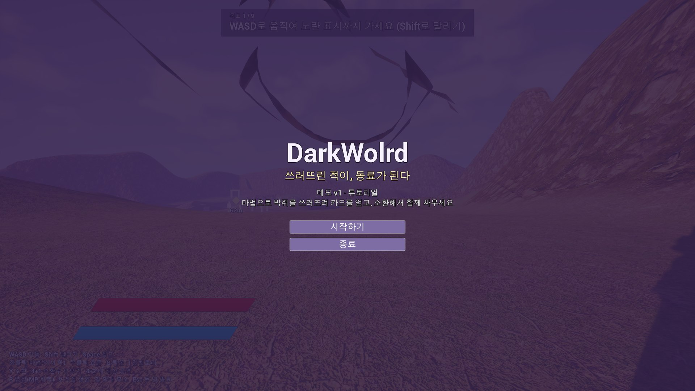
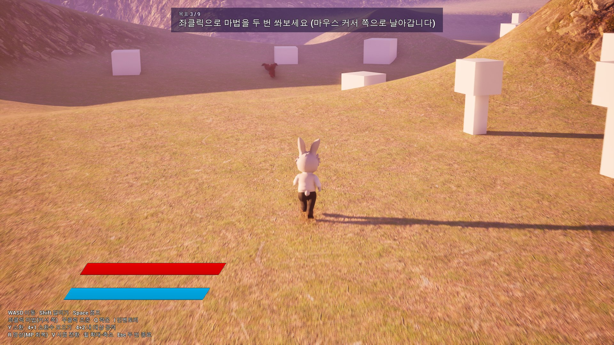
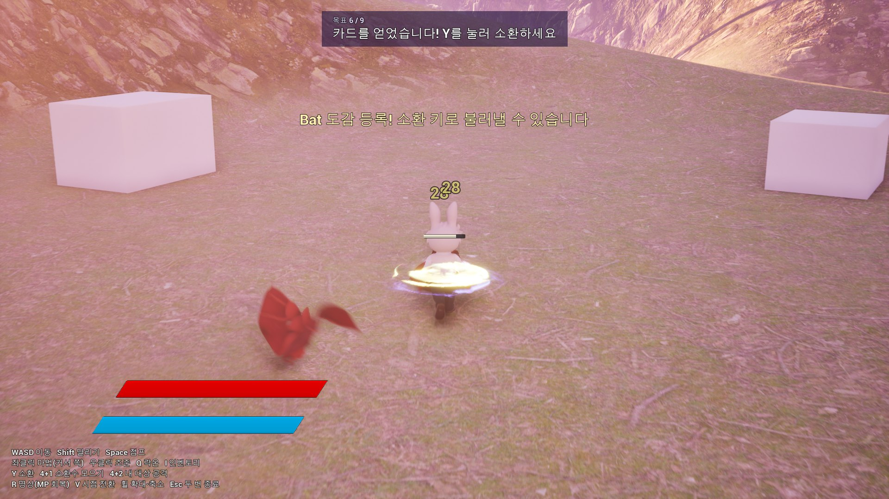
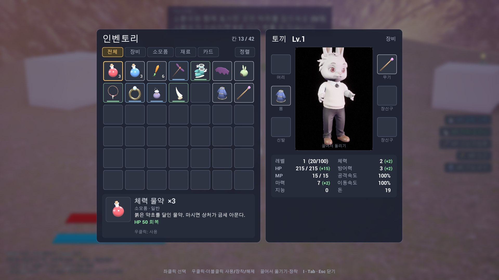
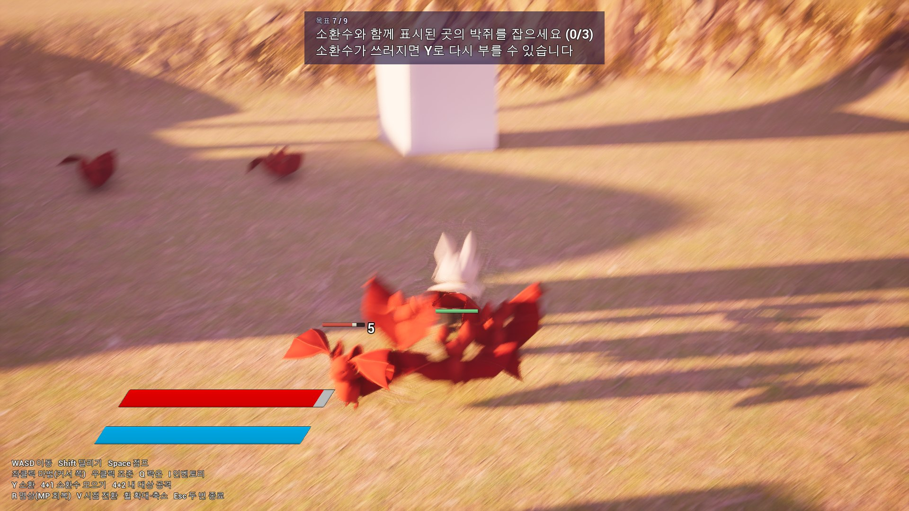
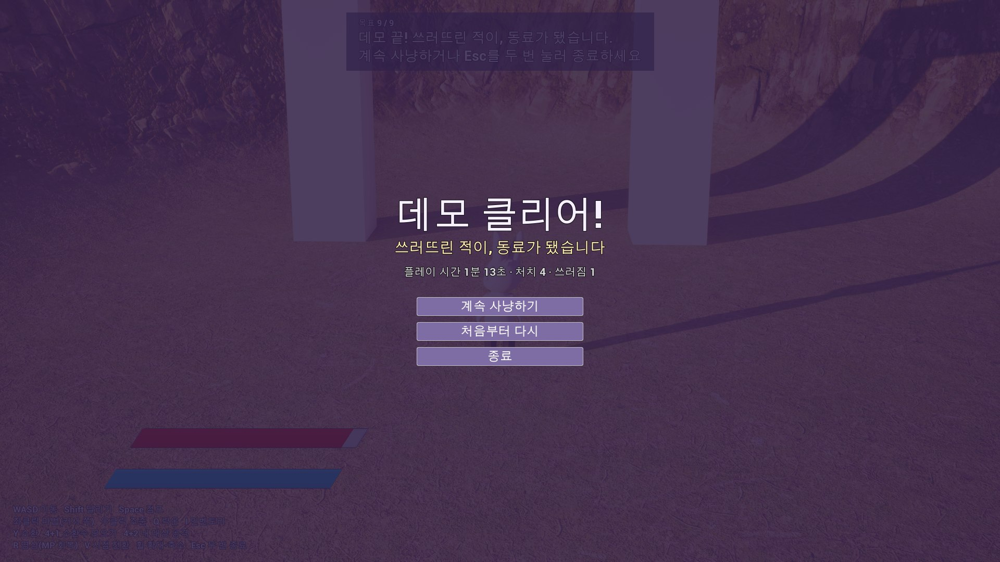

# 스토어 자료 초안 (STOVE)

> 작성 2026-11-20 · 초안. 정식 제목과 판매 방식은 5주차에 확정합니다. 소개문은 **지금 설치본(v0.3.0)에 실제로 있는 것만** 적었습니다. 필드 보스·던전처럼 아직 없는 것은 넣지 않았습니다.

## 기본 정보

| 항목 | 초안 | 상태 |
| --- | --- | --- |
| 제목 | **(정식 제목 입력)** · 가제 DarkWolrd | 5주차 확정 |
| 장르 | 액션 RPG, 몬스터 수집, 소환 | |
| 플랫폼 | PC (Windows 64비트), 키보드 + 마우스 | |
| 언어 | 한국어 | |
| 등급 목표 | 12세 이용가 (판타지 몬스터 전투, 피 표현 없음) | 6주차 등급 분류 |
| 가격 | **(무료 데모 / 유료 입력)** | 미정 |
| 태그 후보 | 액션, RPG, 몬스터 수집, 판타지, 싱글 플레이, 귀여운 | |

## 한 줄 소개

> 쓰러뜨린 적이, 동료가 된다. 토끼 마법사가 몬스터 카드를 모아 함께 싸우는 소환 액션 RPG.

## 짧은 소개 (목록·검색 결과용)

토끼 마법사가 되어 마법으로 몬스터를 쓰러뜨리고, 떨어진 몬스터 카드로 그 몬스터를 동료로 소환하세요. 위에서 내려다보는 시점으로 전장을 한눈에 보며 소환수에게 명령을 내리고 함께 사냥합니다.

## 긴 소개 (상세 페이지)

**쓰러뜨린 적이, 동료가 된다.**

해 질 녘 보랏빛 안개가 내려앉은 들판. 작은 토끼 마법사는 혼자서는 버거운 박쥐 떼를 상대해야 합니다. 마법 구슬로 쓰러뜨린 몬스터는 카드를 남기고, 그 카드로 몬스터를 내 편으로 불러낼 수 있습니다.

- **마법 사냥:** 마우스 커서가 가리키는 쪽으로 마법 구슬을 날립니다. Q로 적을 고정하면 구슬이 따라갑니다.
- **몬스터 카드와 소환:** 쓰러뜨린 몬스터의 카드를 주워 도감에 등록하고, Y로 소환해 함께 싸웁니다. 같은 카드를 또 얻으면 소환수가 강해집니다.
- **소환수 지휘:** "내 곁으로 모여", "내가 공격하는 적을 공격해" 두 가지 명령으로 소환수를 움직입니다.
- **전장을 한눈에:** 위에서 비스듬히 내려다보는 시점이라 소환수와 적의 움직임이 한 화면에 들어옵니다.
- **아이템과 장비:** 물약과 재료를 모으고, 지팡이·두건·로브·신발·장신구를 끼워 마력과 체력을 올립니다.

(데모에는 튜토리얼 들판 한 곳이 들어 있습니다.)

## 스크린샷 (초안)

설치본 v0.3.0의 자동 점검이 개발 PC에서 1920×1080으로 찍은 화면입니다. 화면 위의 목표 안내 문구가 들어가 있어서, 확정본은 안내를 끈 화면으로 다시 찍습니다. STOVE의 스크린샷 규격(크기·개수)은 **확인 필요**입니다.

| | |
| --- | --- |
|  시작 화면 |  해 질 녘 들판, 쿼터뷰 |
|  카드 등록과 아이템 획득 알림 |  인벤토리와 장비 |
|  소환수와 함께 박쥐 사냥 |  클리어 화면 |

## 최소·권장 사양

| | 최소 | 권장 |
| --- | --- | --- |
| OS | Windows 10/11 64비트 | Windows 10/11 64비트 |
| CPU | **(낮은 사양 PC 테스트 후 입력)** | **(입력)** |
| 메모리 | **(입력)** | **(입력)** |
| 그래픽 | **(입력)** | 개발 PC 기준 RTX 4080 SUPER에서 1080p 평균 218fps |
| 저장 공간 | 800MB (v0.3.0 압축 해제 787MB) | 800MB |

## 확정 전에 할 일

- 정식 제목 정하기 (모티브 작품과 겹치지 않게)
- 대표 이미지(캡슐·배너) 만들기, 규격 확인
- 안내 문구를 끈 스크린샷 다시 찍기
- 낮은 사양 PC에서 실행해 최소 사양 채우기
