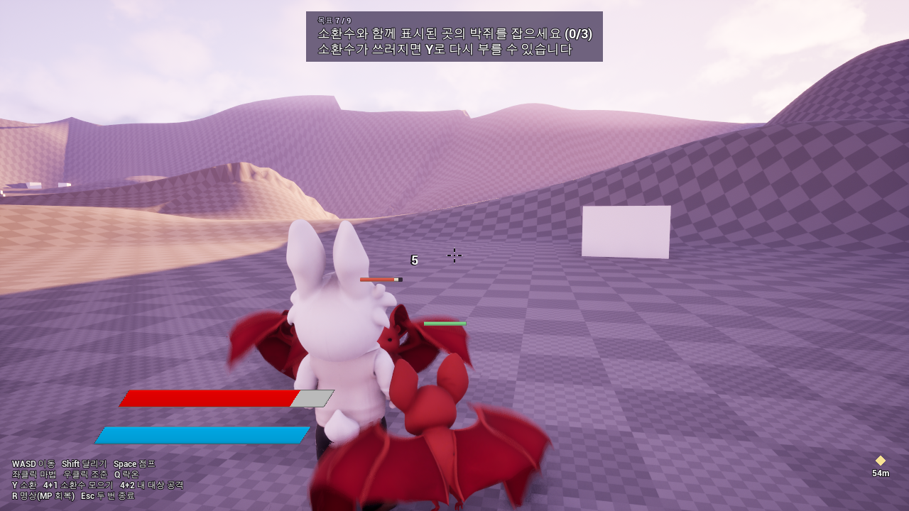

# 2주차 과제 (11/2~11/6)

> LAUNCH:ER Unreal 3기 · 개인 기록

**설치본 v0.1.0을 만들었습니다.** DarkWolrd(가제)는 쓰러뜨린 몬스터를 카드로 모아 함께 싸우는 3인칭 소환 액션 RPG입니다. 이번 주에는 튜토리얼 맵 한 곳에서 사냥 → 카드 → 소환 → 함께 전투 → 출구까지 설치본으로 돌아가게 했습니다.

## 제출 링크 모음

| 산출물 | 링크 | 비고 |
| --- | --- | --- |
| 설치본 v0.1.0 (Windows x64, zip) | **[(업로드 후 입력)](https://drive.google.com/file/d/1ouyDW38Jit_8Kr9UnDsuV9dzQ8Sfyde7/view?usp=sharing)** | `DarkWolrd-v0.1.0-Win64.zip` · 520 MB (풀면 793 MB). 압축을 풀고 `DarkWolrd.exe` 실행 |
| 설치 테스트 결과 | [아래 4번](#4-클린-설치-테스트-결과) | 개발 PC에서 설치본으로 자동 점검. 클린 PC 테스트는 아직 안 함 |
| 빌드 스크립트 | [아래 5번](#5-빌드-스크립트) | [Scripts/BuildRelease.ps1](../../Scripts/BuildRelease.ps1) |
| 체인지로그 | [아래 6번](#6-체인지로그) | [CHANGELOG.md](../../CHANGELOG.md) |
| 플레이 클립 | **(녹화 후 입력)** | 설치본에서 녹화 |
| 주간 기록 #2 | [아래 8번](#8-주간-기록-2-개인) | |

---

## 1. 핵심 루프 그레이박스

> 사냥 → 카드 → 소환 → 함께 전투

마법 구슬로 박쥐를 잡으면 카드가 떨어지고, 카드를 주우면 도감에 등록됩니다. Y로 박쥐를 소환해 함께 싸우고, 출구에 닿으면 데모가 끝납니다.

### 이번 주 범위

| 구분 | 들어간 것 | 이번 버전 제외 |
| --- | --- | --- |
| 맵 | 튜토리얼 그레이박스 1개 (252m 지형, 구역 6개, 스포너 2개, 내비 메시) | 사냥터, 던전 |
| 전투 | 마법 구슬, 조준, 락온, 달리기, 점프 | 필드 보스 |
| 몬스터 | 박쥐 1종 | 다른 종족 |
| 소환 | 카드 드롭·획득·도감 등록, Y 소환, 소환수 지휘 (모으기, 함께 공격) | 소환수 3마리 편성 (한 종족뿐이라 1마리만 나옴) |
| 지는 조건 | 쓰러지면 마지막으로 달성한 목표 위치에서 일어남 | 게임 오버 화면 |
| 한 판의 흐름 | 실행 → 목표 9단계 → 출구 → 계속 사냥하거나 Esc 두 번으로 종료 | 타이틀, 엔딩 화면, 진행 저장 |
| 안내 | 목표 안내, 목표 지점 표시, 조작 안내, 화면 알림 | 설정 메뉴 |
| 연출 | 아래 2번 | 로딩 화면 |

### 그레이박스로 확인한 것

- **한 판이 끝까지 도는지:** 설치본을 실제 키 입력으로 자동 플레이했습니다. 순간이동 없이 걸어서 목표 9개를 모두 달성했고(99초, 쓰러짐 0회), zip을 새 폴더에 풀어 다시 실행해도 통과했습니다(65초).
- **예상과 달랐던 점:** 봇을 돌리자 소환 구역에서 토끼가 3초 만에 쓰러졌습니다. HP 50에 박쥐 4마리가 7.5씩 때렸습니다. 맵을 만든 사람은 막히는 곳을 못 본다는 것을 바로 겪었습니다.
- **지는 조건:** 토끼는 쓰러질 수 있습니다. 다만 게임 오버 없이 마지막 목표 위치에서 일어나 이어 합니다.
- **아직 모르는 것:** 사람이 안내만 보고 끝까지 가는지, 조작감, 소리. 자동 점검으로는 확인할 수 없습니다.

---

## 2. 핵심 순간 반응 연출 (사운드·이펙트)

순간마다 플레이어가 느껴야 할 것을 먼저 정하고 소리와 이펙트를 붙였습니다. 효과음 11종은 코드로 합성해 외부 음원이 없습니다. 재생 호출은 연결했지만 소리를 귀로 들어 확인하지는 못했습니다.

| 핵심 순간 | 느껴야 할 것 | 이펙트 | 사운드 |
| --- | --- | --- | --- |
| 마법 발사 | 쏘는 손맛 | 마법 구슬, 토끼 몸 찌그러짐 | 발사음 |
| 마법 명중 | 맞혔다는 확신 | 라벤더색 충격파, 히트스톱, 피해 숫자 | 충돌음, 타격음 |
| 몬스터 처치 | 해냈다는 쾌감 | 보라색 충격파, 더 긴 히트스톱 | 처치음 |
| 카드 드롭 | 보상을 발견함 | 빛나는 카드 | 드롭음 |
| 카드 획득 | 모았다는 보상감 | 노란 충격파, 도감 등록 알림 | 획득음 |
| 소환 | 쓰러뜨린 적이 동료가 됨 | 청록색 큰 충격파 | 소환음 |
| 소환 해제 | 동료가 돌아감 | 청록색 작은 충격파 | 해제음 |
| 토끼 피격 | 위기감 | 몸 찌그러짐, 히트스톱, 화면 흔들림 | 피격음 |
| 착지 | 무게감 | 몸 찌그러짐, 높은 곳에서 떨어지면 화면 흔들림 | 착지음 |
| 목표 달성 | 앞으로 나아감 | 목표 패널 갱신 | 안내음 |



설치본 자동 플레이 중에 찍은 화면입니다. 토끼 옆에서 소환한 박쥐가 야생 박쥐와 싸우고 있습니다. 위쪽은 목표 안내, 왼쪽 아래는 조작 안내, 오른쪽 아래는 목표 지점까지 남은 거리입니다.

---

## 3. 패키지 빌드 v0.1.0

| 항목 | 내용 |
| --- | --- |
| 버전 | v0.1.0 (2026-11-06 빌드, 코드 커밋 `aeb5681`) |
| 엔진 | Unreal Engine 5.8 |
| 플랫폼 | Windows x64 (Development) |
| 파일 | `DarkWolrd-v0.1.0-Win64.zip` · 520 MB (압축 해제 793 MB) |
| 다운로드 | **(업로드 후 입력)** |
| 실행 방법 | zip 압축 해제 → `DarkWolrd.exe` 실행. 구성요소 설치 창이 뜨면 허용하고, "Windows의 PC 보호" 경고가 뜨면 「추가 정보 → 실행」 |
| 조작 | WASD 이동, 마우스 시점, Shift 달리기, Space 점프, 왼쪽 클릭 마법, 오른쪽 클릭 조준, Q 락온, Y 소환, 4 다음 1 소환수 모으기, 4 다음 2 내 대상 공격, R 명상 |
| 종료 | Esc를 3초 안에 두 번 |

### 주간 빌드 리듬

- 매주 마감 전에 빌드 → 자동 점검 → 설치 테스트 → 체인지로그 → 클립 순서로 반복합니다.
- 파일 이름은 `DarkWolrd-v<버전>-Win64.zip`입니다. 스크립트가 `-Version` 값으로 붙입니다.
- 자동 점검을 통과하지 못하면 zip이 만들어지지 않습니다.

---

## 4. 클린 설치 테스트 결과

개발 PC에서는 설치본으로 확인을 마쳤고, 클린 PC 테스트는 **아직 안 했습니다.** 개발 PC에는 언리얼과 VC++ 런타임이 이미 깔려 있어 클린 설치를 대신할 수 없습니다.

### 테스트 환경

| 항목 | 개발 PC | 클린 PC |
| --- | --- | --- |
| OS | Windows 11 Pro (10.0.26200) | |
| CPU / GPU | AMD Ryzen 9 7950X3D / NVIDIA GeForce RTX 4080 SUPER | |
| 메모리 | 32 GB | |
| 해상도 | 1280 x 720 창 모드 | |
| 언리얼·Visual Studio 설치 | 있음 | |
| 설치 경로 | 영문 폴더, 한글·띄어쓰기 폴더 (`설치 테스트 폴더`) | |

### 체크리스트

| # | 확인 항목 | 개발 PC | 클린 PC | 메모 |
| --- | --- | --- | --- | --- |
| 1 | zip 압축 해제 | ✅ | | PowerShell `Expand-Archive`, 6초 |
| 2 | 한글·공백이 들어간 경로에서 exe 실행 | 🟡 | | 창 없이 실행해 맵 진입, 이동, 종료, 오류 0줄 확인. 끝까지 플레이는 영문 폴더에서만 확인 |
| 3 | 첫 화면까지 걸린 시간 | ✅ | | 약 6초 (로그 시작 → 첫 목표 표시) |
| 4 | 실행 후 로그에 오류 없음 | ✅ | | 오류 0줄, 크래시 없음. 경고 3줄 (드라이버 안내 1, 내비 메시 2) |
| 5 | 사냥 → 카드 → 소환 → 함께 전투 → 출구 | ✅ | | 자동 플레이, 목표 9/9, 쓰러짐 0회 |
| 6 | 창 모드·전체 화면 | 🟡 | | 창 모드만 확인. 전체 화면 전환은 미확인 |
| 7 | 정상 종료 (Esc 두 번) | ✅ | | 로그에 정상 종료 기록 |
| 8 | 소리가 나는지 | ⬜ | | 자동 점검으로 확인 불가 |
| 9 | 사람이 안내만 보고 첫 소환까지 | ⬜ | | 자동 점검으로 확인 불가 |
| 10 | 체감 프레임 | ⬜ | | 자동 점검으로 확인 불가 |

### 발견한 문제와 조치

| 문제 | 원인 | 조치 | 반영 |
| --- | --- | --- | --- |
| 설치본에 Tutorial 맵이 빠짐 | 쿡 목록에 맵이 지정돼 있지 않음 | `MapsToCook`에 Alice와 Tutorial 추가 | v0.1.0 |
| 화면에 "NAVMESH NEEDS TO BE REBUILT" 표시 | 저장된 내비 데이터가 불러올 때 버려짐 | 게임 시작 시 생성으로 변경 | v0.1.0 |
| 에디터가 켜져 있으면 패키징 실패 | Live Coding이 빌드를 막음 | 에디터를 끄거나 `-EditorOpen` 옵션 사용 | v0.1.0 |
| 빌드 스크립트가 경로 때문에 실패 | 공백이 든 엔진 경로를 `cmd /c`가 처리하지 못함 | `Start-Process`로 실행 | v0.1.0 |
| zip을 만들 때 파일 사용 중 오류 | `DarkWolrd.exe`는 시작 파일이라 먼저 끝나고 게임 본체가 파일을 잡고 있음 | 게임 프로세스가 모두 끝날 때까지 대기 | v0.1.0 |
| 첫 몇 초 동안 지형 텍스처가 흐림 | 텍스처 로딩 중 | 로딩 화면으로 가릴 예정 | 다음 버전 |
| 소환수가 1마리만 나옴 | 도감에 박쥐 한 종족뿐 | 다른 종족 추가 | 다음 버전 |

---

## 5. 빌드 스크립트

명령 한 줄로 패키징, 자동 점검, zip 압축까지 끝납니다.

```powershell
powershell -ExecutionPolicy Bypass -File Scripts\BuildRelease.ps1 -Version 0.1.0
```

```text
[1/3] 패키징: Win64 Development, VC++ 재배포 패키지 포함, 디버그 파일 제외
[2/3] 자동 점검: 만든 설치본을 실행해 튜토리얼을 출구까지 플레이
[3/3] 안내문을 넣고 DarkWolrd-v<버전>-Win64.zip으로 압축
```

- 패키징이나 자동 점검이 실패하면 멈추고, zip을 만들지 않습니다.
- 결과물은 `C:\UnrealProject\Builds`에 만들고 저장소에는 넣지 않습니다.
- 점검 로그와 화면은 `DarkWolrd-v<버전>-looptest` 폴더에 남습니다.
- 자동 점검 봇은 [DemoLoopTest.cpp](../../Source/DarkWolrd/Private/Character/DemoLoopTest.cpp)입니다. 실제 키 입력으로 걷고, Shipping 빌드에는 들어가지 않습니다.

```powershell
# Scripts/BuildRelease.ps1 (핵심 부분)
$uatArgs = "BuildCookRun -project=`"$project`" -noP4 -platform=Win64 -clientconfig=Development " +
    "-build -cook -stage -pak -prereqs -nodebuginfo -archive -archivedirectory=`"$archiveDir`" -utf8output -unattended"

$game = Start-Process -FilePath (Join-Path $gameDir 'DarkWolrd.exe') -PassThru `
    -ArgumentList '-DemoLoopTest', '-windowed', '-ResX=1280', '-ResY=720'
$finished = $game.WaitForExit(300000)

if (-not ($results -match 'PASS')) { throw "자동 점검 실패. 기록: $testDir" }

Compress-Archive -Path (Join-Path $gameDir '*') -DestinationPath $zipPath
```

---

## 6. 체인지로그

버전별 기록은 [CHANGELOG.md](../../CHANGELOG.md)에 쌓습니다. 항목은 추가, 변경, 수정, 알려진 문제입니다.

### v0.1.0 (2026-11-06)

첫 설치본입니다. 튜토리얼 맵 한 곳에서 **사냥 → 카드 → 소환 → 함께 전투**를 처음부터 끝까지 해볼 수 있습니다.

**추가**

- **튜토리얼 맵:** 굴곡 있는 252m 지형에 시작, 점프, 조준, 첫 사냥, 소환, 출구 구역을 배치했습니다. 게임을 켜면 이 맵에서 바로 시작합니다.
- **목표 안내 9단계:** 화면 위쪽에 지금 할 일이 나오고, 목표 지점은 노란 표시와 남은 거리로 보입니다. 안내보다 앞서가면 맞는 목표로 건너뜁니다.
- **조작 안내:** 왼쪽 아래에 항상 표시합니다.
- **화면 알림:** 카드 획득, 도감 등록 같은 알림을 화면에 보여줍니다.
- **효과음 11종:** 마법 발사·충돌, 타격, 처치, 카드 드롭·획득, 소환·해제, 피격, 착지, 목표 달성. 코드로 합성해서 외부 음원을 쓰지 않습니다.
- **이펙트:** 마법 충돌, 몬스터 처치, 소환·해제, 카드 획득 순간에 충격파가 나옵니다.
- **빛나는 카드:** 어두운 곳에서도 떨어진 카드가 보입니다.
- **게임 종료:** Esc를 3초 안에 두 번 누르면 꺼집니다.
- **이어서 하기:** 쓰러지면 시작 지점이 아니라 마지막으로 달성한 목표 위치에서 일어납니다.

**변경**

- **시작 맵:** Alice → Tutorial
- **명상 키:** 우클릭 → R
- **난이도:** 토끼 HP 50 → 200, 박쥐 한 방 7.5 → 7. 토끼가 버티는 타격 수가 7번에서 29번으로 늘었습니다.
- **내비 메시:** 저장된 데이터 대신 게임 시작 시 생성합니다.

**수정**

- 조준(우클릭)할 때마다 토끼가 멈추던 문제. 조준과 명상이 같은 키에 묶여 있었습니다.
- 화면에 "NAVMESH NEEDS TO BE REBUILT"가 뜨고 내비 메시가 없던 문제.
- 화면 알림이 디버그 글씨로만 나오던 문제.

**알려진 문제**

- 첫 몇 초 동안 지형 텍스처가 흐리거나 계단처럼 보일 수 있습니다. 로딩 화면이 생기면 가려집니다.
- 지형과 구조물은 회색 임시 상태이고, 타이틀 화면과 설정 메뉴가 없습니다.
- 도감에 한 종족만 있으면 소환수가 1마리만 나옵니다. 기획의 3마리 편성은 박쥐 외 종족을 맵에 넣어야 볼 수 있습니다.

---

## 7. 플레이 클립

**(녹화 후 입력)**

| 구간 | 내용 |
| --- | --- |
| 처음 | `DarkWolrd.exe` 실행 → 튜토리얼 시작 (설치본임을 보여 줌) |
| 중간 | 첫 박쥐 처치 → 카드 드롭·획득 → Y 소환 |
| 끝 | 소환수와 함께 박쥐 3마리 처치 → 출구 → 데모 끝 문구 |

- 녹화: 설치본 화면에서 Win+Alt+R (에디터 화면 아님)

---

## 8. 주간 기록 #2 (개인)

> 양식: ① 계획 대비 실적 ② 테스트에서 발견한 문제 ③ 바뀐 결정과 이유 ④ 다음 주에 할 것·하지 않을 것

### 1. 계획 대비 실적

핵심 루프, 반응 연출, 설치본, 빌드 스크립트, 체인지로그를 끝냈습니다. 마일스톤의 사냥터 그레이박스와 필드 보스 검증은 못 했습니다.

| 계획 | 실적 | 결과 |
| --- | --- | --- |
| 핵심 루프 그레이박스 | 튜토리얼 맵에서 사냥 → 카드 → 소환 → 함께 전투 → 출구 동작 | ✅ |
| 핵심 순간 반응 연출 | 효과음 11종, 충격파 이펙트, 빛나는 카드 | 🟡 소리는 귀로 미확인 |
| 패키지 빌드 v0.1 + 빌드 스크립트 + 체인지로그 | 명령 한 줄로 패키징 → 자동 점검 → zip 520 MB | ✅ |
| 다른 PC 클린 설치 테스트 | 개발 PC에서만 확인 | ⬜ |
| 플레이 클립 | 위 7번 | ⬜ |
| 사냥터 그레이박스 (마일스톤) | 못 함 | ⬜ 3주차로 |
| 필드 보스 1회 검증 (마일스톤) | 못 함. 보스 BP가 아직 없음 | ⬜ 3주차로 |
| 토끼 새 메시·애니메이션 (버릴 수 있는 항목) | 적용 안 함. 기존 토끼 유지 | ⬜ 제외 |

- **한 일:** 튜토리얼 맵 마무리(11/1 커밋) → 목표 안내 → 효과음·이펙트 → 자동 점검 봇·빌드 스크립트 → 설치본·문서(11/6 커밋)
- **숫자:** 이번 주 커밋 3개, 파일 40개 · 쿡 에셋 708개, 오류·경고 0개 · 빌드 2분 6초 · zip 520 MB

### 2. 테스트에서 발견한 문제

| 어디서 | 문제 | 원인 → 조치 |
| --- | --- | --- |
| 자동 플레이 | 소환 구역에서 3초 만에 쓰러짐 | HP 50에 박쥐 4마리 → HP 200, 박쥐 피해 조정, 마지막 목표 위치에서 부활 |
| 자동 플레이 | 조준할 때마다 토끼가 멈춤 | 우클릭에 조준과 명상이 함께 묶임 → 명상을 R로 이동 |
| 설치본 화면 확인 | 화면 알림이 디버그 글씨로만 나옴 | 설치본에서는 안내 역할을 못 함 → 화면 알림 위젯을 안내에 연결 |
| 설치본 화면 확인 | 조작 안내의 화살표 글자가 깨짐 | 글꼴 문제 → "4+1"처럼 표기 변경 |
| 설치본 화면 확인 | 카드 불빛이 너무 밝음 | 밝기 8000 → 1500 |

배운 점:

- 에디터에서 된다고 설치본에서 되는 것은 아닙니다. 쿡 목록에 없는 맵은 설치본에서 빠지고, 디버그 글씨로 나오던 알림은 안내 역할을 하지 못합니다.
- 점검에 순간이동을 쓰면 지형 막힘을 못 찾습니다. 실제 키 입력으로 걷게 해야 처음 하는 사람과 같은 길을 확인할 수 있습니다.
- 주간 빌드는 스크립트 한 줄이 되어야 매주 돌릴 수 있습니다.

### 3. 바뀐 결정과 이유

| 구분 | 결정 | 이유 |
| --- | --- | --- |
| 유지 | 효과음은 코드로 합성 | 외부 음원의 라이선스 문제가 없고, 나중에 교체하기 쉬움 |
| 유지 | 기존 토끼 모델 사용 | 새 메시는 버릴 수 있는 항목이고, 루프 확인이 먼저 |
| 수정 | 시작 맵 Alice → Tutorial | 처음 보는 사람이 설치본만으로 핵심 플레이를 해봐야 함 |
| 수정 | 명상 키 우클릭 → R | 조준과 겹쳐 조준할 때마다 토끼가 멈춤 |
| 수정 | 토끼 HP 200, 쓰러지면 마지막 목표 위치에서 부활 | 튜토리얼에서 3초 만에 쓰러지면 루프를 끝까지 못 봄 |
| 수정 | 내비 메시를 게임 시작 시 생성 | 저장된 데이터가 불러올 때 버려져 몬스터 이동이 불안정해질 수 있음 |
| 제외 (기한부) | 필드 보스 검증 | 보스 BP부터 필요. 이번 주는 설치본 완성을 우선해 3주차로 이동 |
| 제외 (기한부) | 소환수 3마리 편성 확인 | 다른 종족을 넣어야 볼 수 있어 3주차로 이동 |
| 제외 (기한부) | 타이틀 화면 | 튜토리얼 바로 시작으로 루프 확인이 가능해 3주차로 이동 |

**라이브 리뷰 결정 (금요일)**

| 구분 | 결정 | 이유 |
| --- | --- | --- |
| 유지 | **(리뷰 후 입력)** | |
| 수정 | **(리뷰 후 입력)** | |
| 제외 | **(리뷰 후 입력)** | |

### 4. 다음 주에 할 것 · 하지 않을 것 (3주차, 데모 v1)

**할 것 (우선순위 순)**

1. 라이브 리뷰 결정 반영
2. 다른 PC 설치 테스트, 소리·조작감 직접 확인
3. 필드 보스 BP 제작과 1회 플레이 검증
4. 사냥터 그레이박스, 박쥐 외 종족 추가 (소환수 3마리 편성 확인)
5. 던전 연결, 타이틀과 엔딩 화면 연결
6. 외부 플레이테스트 3명 이상과 피드백 정리
7. 새 설치본 + 설치 테스트 + 체인지로그 + 클립

**하지 않을 것**

- 아레나, 자동 사냥 UI: 버릴 수 있는 항목. 처음부터 끝까지 이어진 뒤에 판단합니다.
- 게임패드, 설정 메뉴: 4주차 항목입니다.
- 토끼 새 메시·애니메이션: 데모가 이어질 때까지 기존 토끼를 유지합니다.

### AI 활용

- Claude Code로 튜토리얼 안내, 효과음 합성, 자동 점검 봇, 빌드 스크립트를 구현했습니다.
- 에디터 연결 없이 헤드리스 파이썬으로 에셋 슬롯을 채우고, 저장 뒤 다시 읽어서 확인했습니다.
- 봇이 찍은 설치본 화면을 AI가 직접 보고 빨간 경고 문구 같은 문제를 찾았습니다.

관련 문서: [1페이지 기획서](../01_OnePagePlan.md) · [8주 마일스톤](../02_Milestones.md) · [주간 기록 #1](Week01.md)
