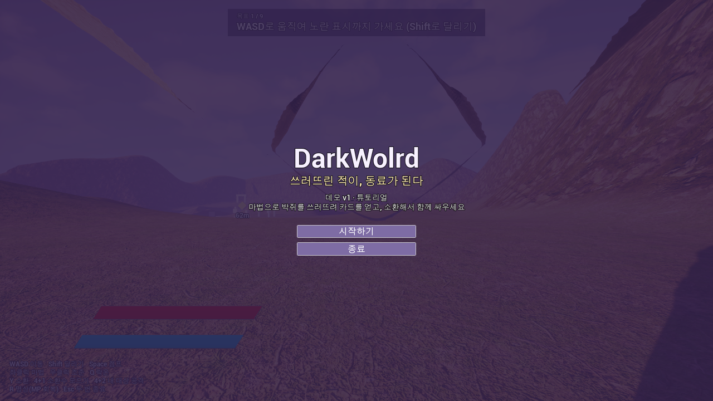
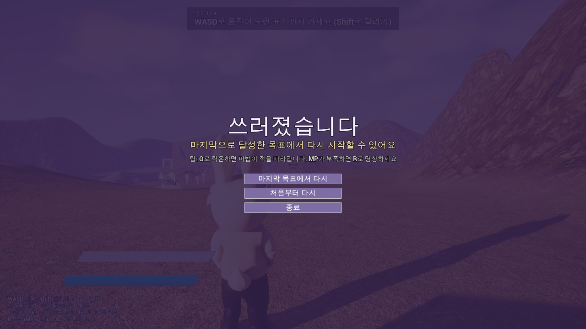
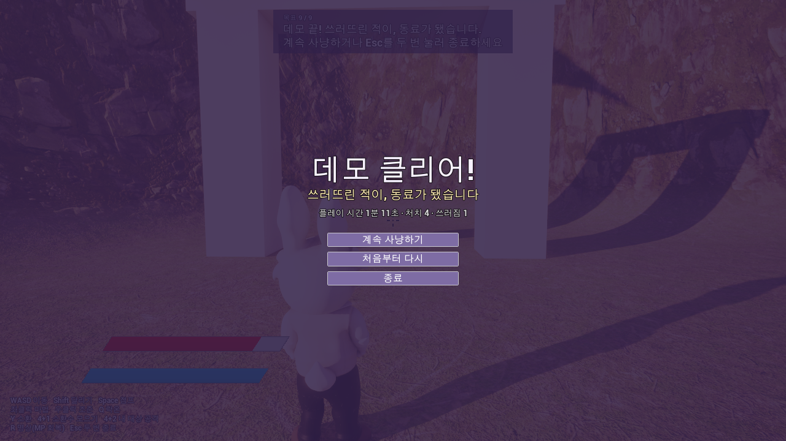
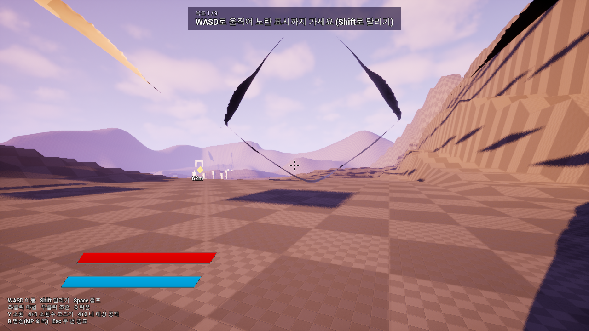
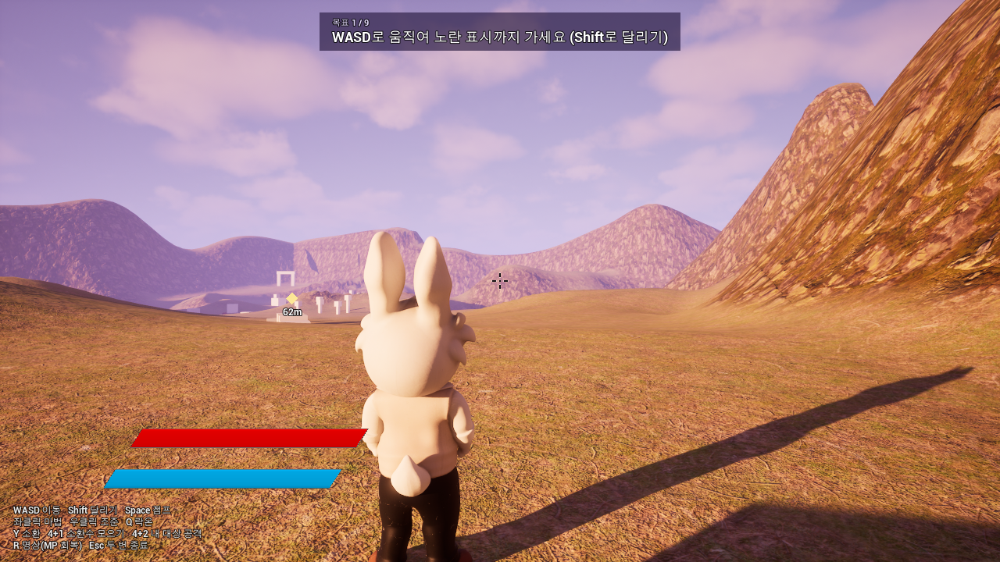

# 3주차 과제 (11/9~11/13)

> LAUNCH:ER Unreal 3기 · 개인 기록

**데모 v1(설치본 v0.2.0)을 만들었습니다.** 게임을 켜면 시작 화면이 나오고, 튜토리얼을 끝내면 클리어 화면, 쓰러지면 실패 화면이 나옵니다. 두 화면 모두 처음부터 다시 할 수 있습니다. 회색이던 지형은 CC0 텍스처로 바꿨습니다.

## 제출 링크 모음

| 산출물 | 링크 | 비고 |
| --- | --- | --- |
| 데모 v1 설치본 (v0.2.0, Windows x64 zip) | [다운로드](https://drive.google.com/file/d/1l6OtJZaCs-DtIWh1WjQ6_W1fcZRtR956/view?usp=sharing) | `DarkWolrd-v0.2.0-Win64.zip` · 536 MB (풀면 809 MB). 압축을 풀고 `DarkWolrd.exe` 실행 |
| 플레이테스트 기록 | [Playtest/v0.2.0.md](../Playtest/v0.2.0.md) | 관찰 기록, 문제 목록(우선순위) |
| 에셋 출처 목록 | [Assets.md](../Assets.md) | 폰트·음원 포함 |
| 역할 맵 | [RoleMap.md](../RoleMap.md) | 1인 역할 시간표, 역할을 넘길 때의 규칙 |
| 주간 기록 #3 | [아래 6번](#6-주간-기록-3-개인) | |

---

## 1. 데모 v1: 시작 → 플레이 → 끝

| 상황 | 화면 | 고를 수 있는 것 |
| --- | --- | --- |
| 게임 실행 | 시작 화면 (제목, 한 줄 소개) | 시작하기, 종료 |
| 플레이 | 튜토리얼 목표 9단계 (이동 → 점프 → 마법 → 첫 사냥 → 카드 → 소환 → 함께 사냥 → 출구) | |
| 실패: 쓰러짐 | 실패 화면 | 마지막 목표에서 다시, 처음부터 다시, 종료 |
| 성공: 출구 도착 | 클리어 화면 (플레이 시간, 처치 수, 쓰러진 횟수) | 계속 사냥하기, 처음부터 다시, 종료 |

- 화면이 떠 있는 동안은 게임이 멈추고 마우스로 버튼을 고릅니다.
- 2주차까지는 쓰러지면 3초 뒤 저절로 일어났습니다. 이제는 실패 화면에서 직접 고릅니다.
- 모든 화면은 위젯 블루프린트 없이 C++로 그렸습니다 ([DemoFlowWidget.cpp](../../Source/DarkWolrd/Private/UI/DemoFlowWidget.cpp)).

| 시작 화면 | 실패 화면 | 클리어 화면 |
| --- | --- | --- |
|  |  |  |

설치본 자동 점검 중에 찍은 화면입니다. 클리어 화면의 "쓰러짐 1"은 봇이 실패 화면을 확인하려고 일부러 한 번 쓰러진 것입니다.

### 자동 점검

빌드 스크립트의 자동 점검 봇이 한 판의 흐름을 모두 지나가도록 늘렸습니다.

```text
title screen ok                      시작 화면 → 시작하기
fail screen ok                       일부러 쓰러짐 → 실패 화면
retry from checkpoint ok             마지막 목표에서 다시
navmesh ok at hunt zone
first monster killed / card registered / summoned / summons dealt damage
guide objective 9 at 70s             목표 9개 달성
clear screen ok, restarting          클리어 화면 → 처음부터 다시
PASS in 72s, rabbit died 1 times (1 on purpose)   시작 화면이 다시 뜨는 것까지 확인
```

---

## 2. 그레이박스 → 아트 교체 1세트: 지형

회색 지형을 숲 바닥과 바위로 바꿨습니다. 화면에서 가장 넓게 보이는 것이 지형이라 한 세트만 바꾼다면 효과가 제일 크다고 판단했습니다.

| 전 (v0.1.0) | 후 (v0.2.0) |
| --- | --- |
|  |  |

두 장 모두 시작 지점에서 설치본 자동 점검이 찍은 화면입니다.

| 항목 | 내용 |
| --- | --- |
| 평지 | Forest Ground 01 (풀, 낙엽, 잔가지). 4m와 17m 두 크기로 섞어 반복 무늬를 줄임 |
| 가파른 언덕 | Aerial Rocks 02 (이끼 낀 바위). 약 37도보다 가파르면 바위 |
| 섞는 방법 | 지형의 기울기로 자동으로 섞어서 칠하기 작업이 필요 없음 |
| 출처 | Poly Haven, CC0. 무료 경로로 진행했고 유료 AI 3D 툴은 쓰지 않음 |
| 적용 | 에디터를 켜지 않고 헤드리스 파이썬으로 텍스처 가져오기, 재질 만들기, 지형에 적용까지 실행 |

---

## 3. 에셋 출처·라이선스 목록

[Assets.md](../Assets.md)에 설치본에 들어가는 에셋을 모두 적었습니다. 설치본의 빌드 컨테이너 목록을 뽑아 실제로 들어간 폴더를 확인했습니다.

- **직접 제작:** 효과음 11종(코드 합성), 박쥐 리그·애니메이션, 지형 재질, 화면 UI
- **AI 생성:** 토끼·슬라임 메시 (Meshy 유료 플랜)
- **무료 에셋:** Mixamo 애니메이션, Poly Haven CC0 텍스처, 엔진 기본 폰트(Roboto, Droid Sans Fallback · Apache 2.0)
- **확인 중:** Fab의 충격파 이펙트. 원본 재배포 금지라 저장소에는 넣지 않았고, 설치본에 넣어 배포하는 조건은 확인하고 있습니다.

---

## 4. 외부 플레이테스트

**(테스트 후 입력)**

---

## 5. 역할 맵

[RoleMap.md](../RoleMap.md)에 게임팀 역할 7개(PD·기획, 프로그래머, 레벨 디자이너, 아티스트, 사운드, QA, 빌드·릴리스)를 혼자 맡는 방식으로 옮겼습니다.

- **역할 시간표:** 월 기획, 화 구현, 수 레벨·아트, 목 구현과 중간 빌드, 금 플레이테스트·빌드·기록
- **넘길 때의 규칙:** 기획에서는 "무엇을 하면 끝인가" 한 줄, 프로그래머는 자동 점검 통과와 체인지로그, 아티스트는 출처 목록 갱신, QA는 우선순위를 붙인 문제 목록을 남깁니다.

---

## 6. 주간 기록 #3 (개인)

> 양식: ① 계획 대비 실적 ② 테스트에서 발견한 문제 ③ 바뀐 결정과 이유 ④ 다음 주에 할 것·하지 않을 것

### 1. 계획 대비 실적

마일스톤의 3주차 목표는 "타이틀 → 튜토리얼 → 사냥 → 필드 보스 → 던전 → 엔딩 화면 연결"이었습니다. 시작·실패·클리어 화면으로 한 판은 이어졌지만, 필드 보스와 던전은 넣지 못했습니다.

| 계획 | 실적 | 결과 |
| --- | --- | --- |
| 타이틀 화면 | 시작 화면 (시작하기, 종료) | ✅ |
| 튜토리얼 → 사냥 | 튜토리얼 맵 안에서 사냥, 카드, 소환, 함께 사냥 | ✅ |
| 성공·실패·재시작 | 클리어 화면, 실패 화면, 처음부터 다시 | ✅ |
| 필드 보스 → 던전 | 못 함 | ⬜ 4주차로 |
| 엔딩 화면 | 클리어 화면으로 대신함. 엔딩 연출은 없음 | 🟡 |
| 그레이박스 → 아트 교체 1세트 | 지형 재질 (CC0) | ✅ |
| 에셋 출처 목록 | 설치본 기준으로 작성. Fab 이펙트 조건은 확인 중 | 🟡 |
| 외부 플레이테스트 3명 이상 | **(테스트 후 입력)** | |
| 역할 맵 | 1인 역할 시간표, 넘길 때의 규칙 | ✅ |
| 아레나, 자동 사냥 UI (버릴 수 있는 항목) | 하지 않음 | ⬜ 제외 |

- **한 일:** 이번 주 작업은 모두 11/13(금) 저녁에 했습니다. 11/7~11/12에는 커밋이 없습니다.
- **숫자:** 쿡 720개, 빌드 오류·경고 0개 · 패키징 1분 35초 · 자동 점검 72초 통과 · 실행 로그 오류 0줄, 경고 3줄(드라이버 안내 1, 종료 시 길찾기 2) · zip 536 MB

### 2. 테스트에서 발견한 문제

**자동 점검에서 (11/13)**

| 문제 | 원인 | 조치 |
| --- | --- | --- |
| 창이 최소화되면 튜토리얼 목표가 넘어가지 않음. 2주차에 창 없이 돌린 점검이 마법 단계에서 멈춘 원인도 같음 | 목표 진행이 위젯 틱 안에 있었는데, 위젯 틱은 창이 그려질 때만 돎 | 목표 진행과 실패·클리어 화면 예약을 캐릭터의 월드 틱으로 옮김 |
| 첫 사냥 구역에 길찾기 데이터가 없어 몬스터·소환수가 못 움직임 | 지형 재질을 넣으며 맵을 다시 저장할 때 빈 길찾기 데이터가 정상 데이터처럼 저장돼, 게임 시작 때 새로 만들지 않음 | 플레이가 시작될 때 코드에서 길찾기를 직접 새로 만듦 |
| 위 문제를 설정(`bForceRebuildOnLoad`)으로 고치려 했지만 효과 없음 | 상세 로그로 보니 시작 때 길찾기를 다시 만드는 코드가 아예 불리지 않음 | 설정은 되돌림 |

**외부 플레이테스트에서**

**(테스트 후 입력)**

배운 점:

- 게임 규칙을 화면(위젯) 코드에 넣으면 화면이 안 그려질 때 게임도 멈춥니다. 진행 로직은 월드 쪽에 둬야 합니다.
- 맵을 다시 저장하는 작업은 그 맵의 다른 데이터(길찾기)까지 바꿀 수 있습니다. 아트만 바꿨어도 자동 점검을 끝까지 돌려야 합니다.

### 3. 바뀐 결정과 이유

| 구분 | 결정 | 이유 |
| --- | --- | --- |
| 수정 | 쓰러지면 자동 부활 → 실패 화면에서 고르기 | 실패가 실패로 보여야 하고, 처음부터 다시 할 길이 있어야 함 |
| 수정 | 화면이 떠 있는 동안 게임 멈춤 | 클리어·실패 화면을 보는 사이에 몬스터에게 맞지 않게 |
| 유지 | 데모는 튜토리얼 맵 한 곳 | 남은 시간 안에 시작부터 끝까지 이어지는 것을 우선 |
| 제외 (기한부) | 필드 보스, 던전 | 이번 주 작업이 금요일 하루에 몰려 시간이 부족. 4주차 첫 작업으로 이동 |
| 제외 (기한부) | 엔딩 연출 | 클리어 화면으로 끝을 대신함 |

**검토 중인 결정 후보: 카메라를 위에서 내려다보는 쿼터뷰로 바꾸기**

- **문제:** 어깨 뒤 3인칭 카메라로는 소환수 1마리가 싸우는 것도 따라보기 어렵습니다. 기획대로 3마리를 데리고 싸우면 누가 누구를 공격하는지 읽을 수 없어 몰입이 깨질 것 같습니다. 3인칭과 생물 동료라는 조합이 팰월드와 비슷해 보인다는 점도 마음에 걸립니다.
- **참고:** 위에서 비스듬히 내려다보는 쿼터뷰 게임(예: 던전에서 죽기 싫어)처럼 전장 전체가 보이는 구도.

| 선택지 | 바뀌는 것 | 그대로 쓰는 것 | 판단 |
| --- | --- | --- | --- |
| A. 쿼터뷰 + 실시간 | 카메라, 조준(마우스 커서 위치로), 락온(대상 클릭) | 카드, 소환, 소환수 AI, 몬스터, 필드 보스, 던전, 효과음, 시작·실패·클리어 화면 | 우선 검토 |
| B. A + 전술 일시정지 | A에 더해 잠깐 멈추고 지휘하기 | A와 같음 | A를 해본 뒤 판단 |
| C. 턴제 + 격자 | 이동, 전투, AI, 맵, UI 전부 | 카드, 도감 정도 | 이번 일정에서는 하지 않음 |

- **턴제를 빼는 이유:** 문제의 원인은 전장을 못 읽는 것이고, 카메라로 대부분 풀 수 있습니다. 4주차가 기능 동결이고 12/4가 심사라, 실시간 전투와 소환수 AI를 새로 짤 시간이 없습니다.
- **쿼터뷰로 잃는 것:** 토끼 표정과 화면 흔들림 같은 가까운 연출이 덜 보이고, 점프 발판의 높이를 읽기 어려우며, 벽이 캐릭터를 가리는 문제를 따로 처리해야 합니다.
- **결정 방법:** 3주차 플레이테스트에서 테스터가 소환수의 행동을 따라가는지 보고, 4주차 초에 카메라 프로토타입을 지금 카메라와 비교한 뒤 정합니다.

### 4. 다음 주에 할 것 · 하지 않을 것 (4주차, 중간 점검)

**할 것 (우선순위 순)**

1. 플레이테스트 문제 목록의 P0, P1
2. 쿼터뷰 카메라 프로토타입: 내려다보는 각도, 마우스 쪽으로 쏘기, 클릭으로 소환수 공격 지시. 지금 카메라와 비교 테스트 후 채택 여부 결정
3. 필드 보스 BP와 던전 연결 (3주차에서 이동)
4. 출시 체크리스트: 설정 메뉴(해상도, 음량), 종료 버튼, 저장 유지, 크래시 없음
5. 테스트 PC에서 60fps 확인, 다른 PC 설치 테스트
6. Fab 이펙트 배포 조건 확인. 안 되면 직접 만든 이펙트로 교체
7. 역할 시간표대로 목요일 중간 빌드

**하지 않을 것**

- 턴제 전환: 전투, AI, 맵을 새로 짜야 해서 심사 일정 안에 할 수 없습니다.
- 아레나, 자동 사냥 UI: 기능 동결 전에 시작하지 않습니다.
- 새 맵 추가: 튜토리얼 맵과 필드 보스·던전 연결이 먼저입니다.

### AI 활용

- Claude Code로 시작·실패·클리어 화면과 자동 점검 봇의 새 단계를 구현했습니다.
- 지형 재질은 에디터 없이 헤드리스 파이썬으로 텍스처 가져오기부터 지형 적용까지 실행했습니다.
- 설치본의 빌드 컨테이너 목록을 뽑아 에셋 출처 목록의 대상을 정했습니다.

관련 문서: [체인지로그](../../CHANGELOG.md) · [8주 마일스톤](../02_Milestones.md) · [주간 기록 #2](Week02.md)
