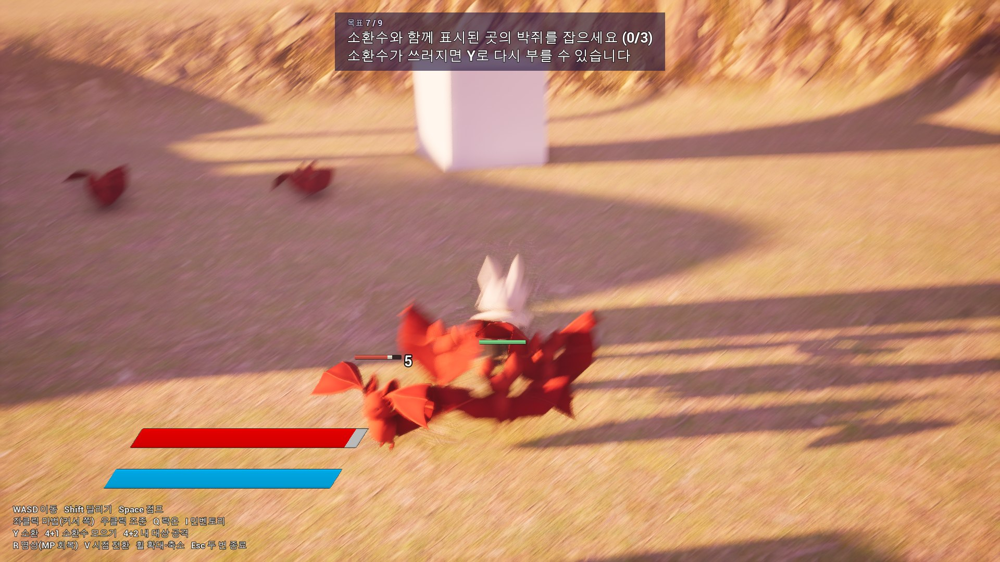
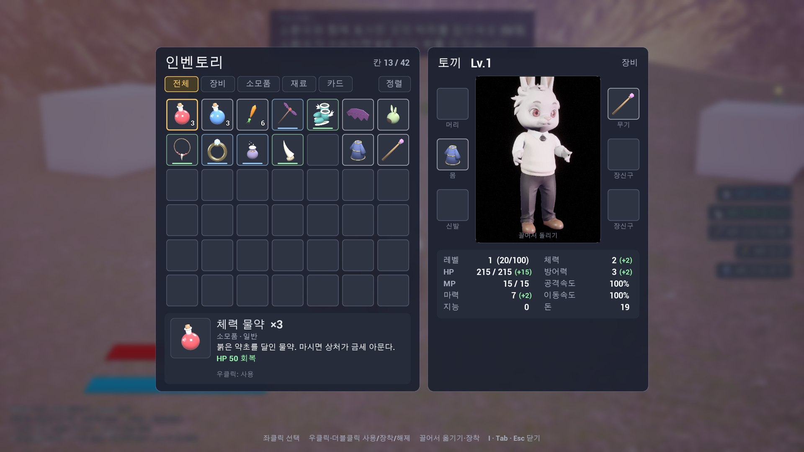
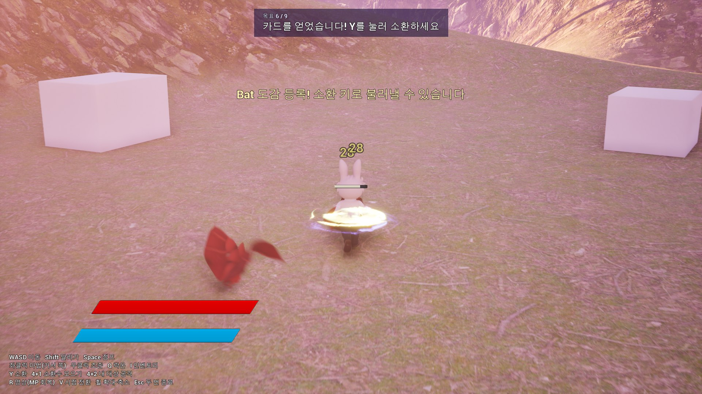
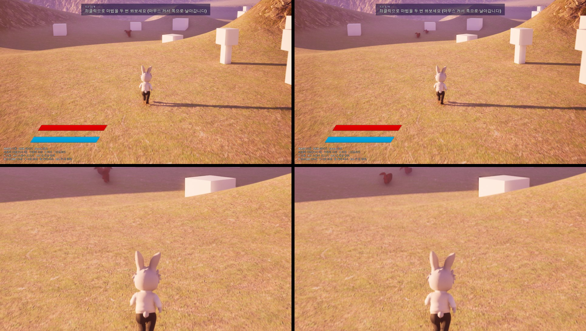

# 4주차 과제 (11/16~11/20)

> LAUNCH:ER Unreal 3기 · 개인 기록

**중간 빌드 v0.3.0을 만들었습니다.** 카메라가 위에서 내려다보는 쿼터뷰로 바뀌었고, 마법은 마우스 커서 쪽으로 날아갑니다. 인벤토리와 장비를 넣었습니다. 설치본 자동 점검은 시작 화면부터 클리어 후 다시 하기까지 통과합니다. 같은 경로를 도는 점검 봇으로 성능을 재서, 화면 차이 없이 GPU 시간을 11% 줄였습니다.

## 제출 링크 모음

| 산출물 | 링크 | 비고 |
| --- | --- | --- |
| 중간 빌드 (v0.3.0, Windows x64 zip) | **(업로드 후 링크 입력)** | `DarkWolrd-v0.3.0-Win64.zip` · 515 MB (풀면 787 MB). 압축을 풀고 `DarkWolrd.exe` 실행 |
| 볼륨업 수치표 | [VolumeUp.md](../VolumeUp.md) | v0.2.0 / v0.3.0 / v1.0 목표(제안) |
| 버그 목록 | [BugList.md](../BugList.md) | P0 2, P1 3, P2 8 · 이번 주 고친 것 5 |
| 성능 개선 전후 기록 | [Performance/v0.3.0.md](../Performance/v0.3.0.md) | GPU 4.16 → 3.70ms, 199 → 218fps, 화면 비교 |
| 출시 체크리스트 | [ReleaseChecklist.md](../ReleaseChecklist.md) | STOVE 공식 문서 기준 |
| 스토어 자료 초안 | [Store/StoreDraft.md](../Store/StoreDraft.md) | 소개문, 스크린샷 6장 |
| 출시 이후 전략 | [PostLaunch.md](../PostLaunch.md) | 패치 리듬, 작은 마케팅 시점 |
| 포트폴리오 목차 | [Portfolio.md](../Portfolio.md) | 정량·정성 목차, 히스토리 점검 |
| 5~6주 계획, 컷한 기능 도입 로드맵 | [Roadmap.md](../Roadmap.md) | 기능 동결 규칙, 요일별 계획 |
| 체인지로그 | [CHANGELOG.md](../../CHANGELOG.md#v030-2026-11-20--중간-빌드) | v0.3.0 |
| 주간 기록 #4 | [아래 10번](#10-주간-기록-4-개인) | |

---

## 1. 중간 빌드 v0.3.0

| 쿼터뷰로 박쥐 사냥 | 인벤토리와 장비 | 카드 등록과 아이템 획득 알림 |
| --- | --- | --- |
|  |  |  |

설치본 자동 점검이 1920×1080으로 찍은 화면입니다. 인벤토리 화면은 점검 봇이 아이템을 종류마다 1개씩 넣고 찍었습니다.

| 바뀐 것 | 내용 |
| --- | --- |
| 카메라 | 위에서 15° 내려다보며 토끼를 따라감. 휠로 거리 조절, V로 예전 어깨 뒤 시점과 전환 |
| 조준 | 커서가 보이고 마법이 커서 쪽으로. 적 근처를 가리키면 그 적을 겨눔. Q 락온도 커서 근처 적 먼저 |
| 인벤토리 (I, Tab) | 탭 5개, 7×6 칸, 설명, 토끼 모습, 장비 6칸, 능력치. 우클릭 사용·장착, 끌어서 옮기기 |
| 아이템 | 13종 (소모품 3, 재료 3, 장비 7). 박쥐가 확률로 떨어뜨리고 가까이 가면 주워짐 |
| 능력치 | 마법 피해에 마력·지능 반영. 장비 보너스는 저장되는 기본 능력치와 따로 계산 |
| 토끼 애니메이션 | 공격 순간 몸이 홱 돌던 것, 출발·정지 때 발 미끄러짐, 명상 때 발이 바닥에 묻힘 수정. 달리며 점프, 착지 직전 다리 뻗기 추가 |

**자동 점검 (설치본)**

```text
title screen ok / fail screen ok / retry from checkpoint ok
item drops on the ground: 2 PotionHP x1, FangNecklace x1        박쥐 드랍
inventory open=1, ... equipped: ApprenticeWand, ApprenticeRobe   인벤토리 열림, 시작 장비
equipment check: magic 7 -> unequip 5 -> re-equip 7 (ok)         장비 빼기·끼기가 능력치에 반영
potion check: used=1, count 5 -> 4, HP 209 -> 215 / 215          물약 사용
exit reached in 68s / clear screen ok, restarting
PASS in 70s, rabbit died 1 times (1 on purpose)
```

---

## 2. 볼륨업 수치표

[VolumeUp.md](../VolumeUp.md). 콘텐츠는 맵 1, 몬스터 1종, 아이템 13, 장비 칸 6, 토끼 애니메이션 26입니다. v1.0 목표는 기능 동결을 지키는 쪽으로 잡은 제안입니다. 기획서의 첫 클리어 25분은 필드 보스와 던전이 들어간 값이어서, 튜토리얼 맵만으로는 닿지 않습니다.

## 3. 버그 목록과 우선순위

[BugList.md](../BugList.md). 외부 플레이테스트 결과가 없어서 소스·자동 점검으로 찾은 것만 적었습니다.

- **P0:** 설치본이 Development 빌드다(STOVE는 언리얼에 Shipping을 안내함). 설정 메뉴(해상도·음량)가 없다.
- **P1:** 게임을 끄면 진행이 남지 않는다. 저장 코드는 있지만 저장을 시작하는 함수를 아무 데서도 부르지 않는다. 그 밖에 Fab 이펙트 배포 조건 미확인, 소환수가 1마리만 나옴.

## 4. 성능 측정과 개선 1건

[Performance/v0.3.0.md](../Performance/v0.3.0.md)

| 1920×1080, 개발 PC | 전 | 후 | 변화 |
| --- | --- | --- | --- |
| 평균 fps | 199.2 | 218.4 | +9.6% |
| GPU 시간 | 4.16ms | 3.70ms | −11.1% |
| TSR / 볼류메트릭 포그 패스 | 0.735 / 0.311ms | 0.415 / 0.130ms | −44% / −58% |

- **방법:** 같은 길을 도는 점검 봇이 매 프레임 프레임·스레드·GPU 시간을 기록하고, CSV 프로파일러로 GPU 패스별 시간을 뽑았습니다.
- **가는 길에 알게 된 것:** 판마다 260ms까지 튀던 끊김은 봇의 스크린샷 때문이었습니다. 레이 트레이싱을 끄거나 소프트웨어 Lumen으로 바꾸는 시도는 효과가 없어 버렸습니다.
- **바꾼 것:** 에픽 품질의 TSR 기록 해상도와 포그 격자를 하이 단계 값으로 낮췄습니다. 화면 차이는 스크린샷으로 구분되지 않습니다.



## 5. 출시 체크리스트

[ReleaseChecklist.md](../ReleaseChecklist.md). STOVE Studio 공식 문서를 읽고 옮겼습니다.

- **새로 알게 된 것:** 언리얼은 Shipping 실행 파일을 써야 합니다. PC SDK를 넣지 않고 빌드를 올리면 DRM Maker가 필수 SDK를 붙여 줍니다. 출시 전에 계약·정산 서류를 끝내야 합니다.
- **끝난 것:** 빌드 자동화, 시작→끝→다시 하기, 개발 PC 60fps.
- **남은 것:** 설정 메뉴, 저장 유지, Shipping, 아이콘, 클린 설치, 최소 사양, 정식 제목, 등급 분류, STOVE 등록.

## 6. 스토어 자료 초안

[Store/StoreDraft.md](../Store/StoreDraft.md). 한 줄 소개, 짧은·긴 소개문, 스크린샷 6장, 사양표 틀이 들어 있습니다. 소개문에는 지금 설치본에 있는 것만 적었습니다. 정식 제목과 가격은 5주차에 정합니다.

## 7. 출시 이후 전략과 작은 마케팅 시점

[PostLaunch.md](../PostLaunch.md). 출시 후 2주는 주 1회 버그 패치, 그다음 첫 업데이트는 필드 보스입니다. 작은 마케팅은 개발기 글과 짧은 플레이 영상을 세 번 올리는 것을 제안했습니다(5주차 금, 심사 신청일, 승인 후). 채널은 **(결정 입력)**.

## 8. 포트폴리오 목차와 히스토리 점검

[Portfolio.md](../Portfolio.md). 히스토리를 점검해 보니 4주차 작업이 커밋 전이어서 11/20에 주제별로 나눠 커밋했습니다. 3주차 플레이테스트 기록지는 아직 비어 있어 5주차 첫날에 정리합니다.

## 9. 5~6주 계획과 컷한 기능 도입 로드맵

[Roadmap.md](../Roadmap.md)

- **기능 동결 (11/23~):** 버그 수정, 출시 체크리스트 항목, 스토어 자료만 넣습니다.
- **5주차:** Shipping, 설정 메뉴, 저장 시작, 외부 플레이테스트 3명, 스토어 자료 확정, STOVE 등록·계약 시작.
- **6주차:** 출시 후보 빌드, 클린 설치, 업로드, 등급 분류, 12/4 심사 신청.
- **컷한 기능:** 필드 보스, 몬스터 추가, 던전, 클릭 지휘, 가림 처리, 장비 겉모습, 제작, 아레나 순서로 출시 뒤에 넣습니다.

---

## 10. 주간 기록 #4 (개인)

> 양식: ① 계획 대비 실적 ② 테스트에서 발견한 문제 ③ 바뀐 결정과 이유 ④ 다음 주에 할 것·하지 않을 것

### 1. 계획 대비 실적

3주차에 적은 4주차 할 일과 비교했습니다.

| 계획 | 실적 | 결과 |
| --- | --- | --- |
| 플레이테스트 문제 목록의 P0, P1 | 플레이테스트 기록이 비어 있어 하지 못함 | ⬜ |
| 쿼터뷰 카메라 프로토타입 | 기본 시점으로 넣음. 커서 조준, V로 비교 가능. 클릭으로 소환수 지시는 못 함 | 🟡 |
| 필드 보스 BP와 던전 연결 | 못 함 | ⬜ v1.0에서 빼는 것을 제안 |
| 출시 체크리스트 | 초안 작성. 설정 메뉴·저장 유지는 아직 없음 | 🟡 |
| 테스트 PC 60fps, 다른 PC 설치 | 개발 PC 1080p 평균 218fps. 다른 PC는 못 함 | 🟡 |
| Fab 이펙트 배포 조건 | 못 함 | ⬜ |
| 목요일 중간 빌드 | 금요일에 v0.3.0 | 🟡 하루 늦음 |
| (계획에 없음) 인벤토리·장비 | 아이템 13종, 장비 6칸, 팰월드식 화면 | ➕ |
| (계획에 없음) 토끼 애니메이션 다듬기 | 공격·출발·정지·점프·명상 등 | ➕ |

- **한 일:** 이번 주 작업은 11/19(목)과 11/20(금)에 했습니다. 새 토끼 에셋은 11/14(토)에 처음 가져왔습니다. 11/20에 주제별로 커밋했습니다(새 토끼, 카메라·인벤토리, 점검 봇·성능, 문서).
- **숫자:** 빌드 → 점검 → zip 3분 58초 · zip 515 MB · 자동 점검 70초 통과 · 1080p 평균 218fps · C++ 103개 파일 13,567줄

### 2. 테스트에서 발견한 문제

**자동 점검과 측정에서 (11/20)**

| 문제 | 원인 | 조치 |
| --- | --- | --- |
| 쿼터뷰로 바꾼 뒤 점검 봇이 사냥 중 예정에 없이 쓰러짐 (55°·25° 판) | 커서가 적과 동떨어져 있으면 락온 후보가 계속 비었음. 공격하면 몸이 커서 쪽으로 돌아 "몸 앞 60°"도 빔 | 커서 방향 → 가장 가까운 적 순으로 고름. 이후 예정 외 사망 0 |
| 박쥐가 아이템을 하나도 안 떨어뜨림 (봇 세 판 연속) | 드랍 설정을 넣는 스크립트를 돌릴 때 다른 에디터가 박쥐 BP 파일을 잡고 있어 저장 실패 | 에디터를 닫고 다시 저장. 스크립트가 저장 실패를 로그에 남기게 함 |
| 게임을 끄면 진행이 남지 않음 | 저장을 시작하는 함수를 아무 데서도 부르지 않음 (캐릭터 선택 화면 없이 남은 연결) | 버그 목록 P1, 5주차 |
| 판마다 260ms 끊김 | 봇이 찍는 스크린샷 | 측정 결과에서 원인을 밝히고 제외 |

**외부 플레이테스트에서**

**(테스트 후 입력)**

배운 점:

- 파일을 잡고 있는 프로그램이 있으면 에셋 저장은 조용히 실패할 수 있습니다. 스크립트는 저장 결과를 꼭 확인해야 하고, "저장했다"는 로그만 믿으면 안 됩니다.
- 성능 수치에는 측정 도구의 영향(스크린샷)이 섞일 수 있습니다. 튄 프레임은 원인을 확인하기 전에 결론에 쓰지 않습니다.
- fps가 높은 PC에서는 렌더 스레드가 병목이라 GPU 개선이 fps에 덜 드러납니다. GPU 시간을 따로 봐야 낮은 사양 PC에 대한 효과를 말할 수 있습니다.

### 3. 바뀐 결정과 이유

| 구분 | 결정 | 이유 |
| --- | --- | --- |
| 수정 | 카메라: 어깨 뒤 3인칭 → 쿼터뷰 (3주차 후보 A) | 소환수와 적의 움직임을 한 화면에서 읽기 위해. 예전 카메라는 V로 남겨 비교 가능 |
| 수정 | 쿼터뷰 각도 55° → 45° → 25° → 15° | 직접 보면서 고름 **(이유 입력)** |
| 보류 | 우클릭으로 화면 회전: 만들어 두고 꺼 둠 | 화면은 잘 돌아가지만 몰입감에 도움이 될지 아직 판단이 서지 않음 |
| 추가 | 인벤토리·장비 (기획서에서는 "안 해도 됨") | **(이유 입력)**. 다이어트 기준("잡고 → 카드 → 소환")과는 거리가 있어, 이 이상 늘리지 않고 동결 |
| 수정 | 마법 피해에 마력·지능 반영 | 장비의 마력 보너스가 의미를 가지려면 필요. 기본 능력치에서는 예전과 같은 피해 |
| 수정 | 에픽 품질의 TSR·포그 설정 일부를 하이 값으로 | 화면 차이 없이 GPU −11% |
| 제외 제안 | 필드 보스·던전을 v1.0에서 빼고 출시 뒤 업데이트로 | 3주차·4주차에 모두 못 했고, 5주차부터 기능 동결. **(결정 입력)** |

### 4. 다음 주에 할 것 · 하지 않을 것 (5주차, 기능 동결)

**할 것 (우선순위 순)**

1. 버그 P0: Shipping 빌드, 설정 메뉴(해상도·창 모드·음량·종료)
2. 버그 P1: 저장 시작 연결 (데모에 넣기로 하면)
3. 외부 플레이테스트 3명 이상 (v0.3.0, 설명 없이)
4. 스토어 자료 확정: 정식 제목, 소개문, 안내를 끈 스크린샷, 대표 이미지, 최소 사양
5. STOVE Studio 가입·프로젝트 등록·계약 시작, Fab 이펙트 조건 정리
6. 목요일 중간 빌드 v0.4.0

**하지 않을 것**

- 새 콘텐츠와 새 시스템: 필드 보스, 던전, 몬스터 추가, 제작, 장비 겉모습. 모두 [로드맵](../Roadmap.md#컷한-기능-도입-로드맵)에 적고 출시 뒤로 미룹니다.
- 우클릭 화면 회전 켜기: 플레이테스트에서 판단한 뒤에 정합니다.

### AI 활용

- Claude Code와 언리얼 MCP로 쿼터뷰 카메라, 인벤토리·장비, 토끼 애니메이션 수정을 구현하고 에디터에 적용했습니다.
- 아이템 아이콘 13개는 Blender를 창 없이 스크립트로 돌려 간단한 3D 모형을 만들고 렌더링했습니다. 외부 에셋은 쓰지 않았습니다.
- 점검 봇에 인벤토리 확인과 프레임 시간 기록을 넣고, 같은 설치본에 설정만 바꿔 돌리는 방식으로 성능 전후를 비교했습니다.
- STOVE Studio 문서를 검색해 출시 체크리스트의 STOVE 항목을 채웠습니다.

관련 문서: [체인지로그](../../CHANGELOG.md) · [8주 마일스톤](../02_Milestones.md) · [주간 기록 #3](Week03.md) · [애니메이션 수정 기록](../RabbitAnimChanges.md)
